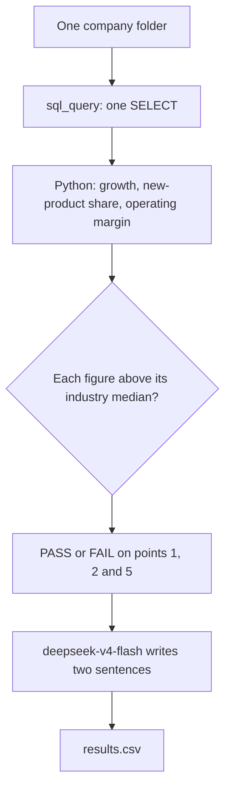

# FTEC5660 Homework 3: Fisher's 15-Point Investment Agent

Build a LangChain agent that researches a company with tools and applies the
framework from Philip Fisher's *Common Stocks and Uncommon Profits* (Part One,
Chapter 3 "What to buy: the fifteen points to look for in a common stock", and
Chapter 4 "What to buy: applying this to your own needs"). You choose 3 of
Fisher's 15 points and decide yourself what PASS means for each. For every
company your agent gives a PASS/FAIL verdict on your 3 points and a short
summary.

The companies are fictional, so the model cannot answer from memory. Unlike a
pile of reports, the evidence is spread over three sources, and your agent has
to go and get it with tools, the way Fisher's "scuttlebutt" method sends an
investor to talk to customers, competitors, suppliers and staff.

## Data and tools

`public_test/` has one folder per company. Your code receives four tools per
company (built by the provided code in `hw3.py`):

| Tool | What it gives you |
| --- | --- |
| `list_documents()` | the company's six documents and their dates |
| `read_document(name)` | one document: the 2025 letter to shareholders, four earnings calls (Q3 2025 to Q2 2026) and a news file (July 2025 to July 2026) |
| `sql_query(query)` | one read-only SQLite query on the company's database; at most 50 rows come back, so use `SUM`, `GROUP BY` and `WHERE` |
| `interview(role, topic)` | what one person says about the company; at most **10 interviews per company** |

The documents are what management says. Management's own claims (such as "we
have never cut research" or "our people are our greatest strength") are not
evidence on their own: check them against the database and the interviews.

**Database tables** (amounts in USD thousands; dates `YYYY-MM-DD`, months
`YYYY-MM`, quarters like `2025Q3`; the fiscal year is the calendar year):

| Table | Columns |
| --- | --- |
| `company` | name, industry |
| `industry_medians` | industry, revenue_growth_2y_pct, new_product_share_pct, new_product_sales_per_rd, operating_margin_pct (one row per industry; use the row for the company's own industry) |
| `orders` | order_id, order_date, product, customer, amount, note (about 3,000 to 4,000 orders from January 2023 to June 2026; revenue is the sum of order amounts) |
| `products` | product, launch_date |
| `monthly_costs` | month, cost_of_sales, selling_admin, research_development |
| `quarterly_cash` | quarter, operating_cash_flow, capex, cash_end |
| `capex_plan` | year, planned_capex (2026 to 2028) |
| `returns` | month, units_shipped, units_returned |
| `insider_trades` | trade_date, person, title, side (`buy` or `sell`), shares, price |

**Terms used in the data.**

| Term | Meaning |
| --- | --- |
| FY2025 | Fiscal year 2025. Here the fiscal year is the calendar year, so FY2025 is January to December 2025. |
| Quarter | Three months of the year: Q1 is January to March, Q2 April to June, Q3 July to September and Q4 October to December. The database writes `2025Q3`; the documents write "third quarter 2025". |
| Amounts | The database is in **USD thousands** (676,100 means US$676.1 million). The documents use USD millions. |
| Revenue | Money from sales: the sum of `amount` in `orders`. |
| Cost of sales | The cost of making the products that were sold. |
| Selling and admin | The cost of selling and of running the company (sales staff, offices, management). |
| R&D | Research and development spending, mainly on new products. |
| Operating margin | Operating profit as a share of revenue: (revenue − cost of sales − selling and admin − R&D) ÷ revenue. |
| Operating cash flow | Cash that the day-to-day business brings in during a quarter. |
| Cash at the end of a quarter | The cash the company holds on the last day of that quarter (`cash_end`). |
| Capex | Capital expenditure: spending on factories, machines and other long-term assets. `capex_plan` holds the planned capex for 2026 to 2028. |
| Return rate | Units returned ÷ units shipped, from the `returns` table. |
| Industry median | The middle value for companies in the same industry, from `industry_medians`. |
| Insider | A director or senior manager of the company. `insider_trades` lists the shares they bought (`buy`) or sold (`sell`). |
| Earnings call | A meeting each quarter where management presents the quarter's results to investors. Each call quotes that quarter's revenue. |

**Interviews.** Roles: `customer`, `current_employee`, `former_employee`,
`competitor`, `supplier`. Topics: `sales_team`, `working_conditions`,
`top_management`, `decision_making`, `competitive_edge`. Only some people know
about each topic; the others say they can't comment, and that answer still
uses up one interview.

| Topic | Who knows about it |
| --- | --- |
| `sales_team` | customer, competitor |
| `working_conditions` | current_employee, former_employee |
| `top_management` | former_employee, supplier |
| `decision_making` | supplier, customer |
| `competitive_edge` | competitor, customer |

People who know about a topic always agree with each other, so one good answer
is enough.

## Choose your 3 points and your rules

Pick any 3 of Fisher's 15 points and write them in `CHOSEN_POINTS` near the
top of `hw3.py`, e.g. `CHOSEN_POINTS = [1, 7, 15]`. The full questions are in
`FISHER_POINTS` in `hw3.py` and in the book.

| # | Fisher's point | Where the evidence is |
| --- | --- | --- |
| 1 | Market potential for sales growth | database |
| 2 | New products as current lines mature | database |
| 3 | Effective research and development | database |
| 4 | Above-average sales organization | interviews (`sales_team`) |
| 5 | Worthwhile profit margin | database |
| 6 | Maintaining or improving margins | database |
| 7 | Labour and personnel relations | interviews (`working_conditions`) |
| 8 | Executive relations | interviews (`top_management`) |
| 9 | Depth of management | interviews (`decision_making`) |
| 10 | Cost analysis and accounting controls | earnings calls, checked against the database |
| 11 | Advantage over competitors | interviews (`competitive_edge`) |
| 12 | Long-range outlook on profits | database |
| 13 | Growth without dilutive equity financing | database |
| 14 | Management talks freely about troubles | earnings calls, checked against the database |
| 15 | Management of unquestionable integrity | news file, checked against the database |

For each of your points, **you design the rule**: which evidence to use, what
to compute or whom to ask, and where the line between PASS and FAIL lies. PASS
means the company looks favourable on that point, as Fisher would see it.

We grade your verdicts against our own answer key. It uses one fixed rule per
point, which we do not publish, and the data never puts a company close to
the line of that rule, so a sensible reading of Fisher usually gives the same
answer. **Test your rules on the public answers**:
`public_test/ground_truth.json` gives the expected verdict on all 15 points
for each of the 20 public companies, and every point fails in 6 of them. If
your rule disagrees with the public answers, rethink it.

**Tip: calculate with tools, not in your head.** Do every sum, ratio and
comparison in SQL or Python, including the number of days between two dates
(SQLite's `julianday()` gives a date as a number of days).

## Student task

Fill in the three places in `hw3.py` marked `### YOUR CODE HERE`. You may add
imports, constants and helper functions above them, but do not change the
provided code below them:

- `CHOSEN_POINTS` lists your 3 points.
- `build_agent()` creates your model and anything else you need once.
- `analyze_companies(agent, companies)` receives
  `{company_folder: [list_documents, read_document, sql_query, interview]}`
  and returns, for every company,
  `{"points": {1: "PASS", 7: "FAIL", 15: "PASS"}, "summary": "..."}` (here with
  `CHOSEN_POINTS = [1, 7, 15]`).

Use the course techniques that fit your points: tool use for the database and
the interviews, planning which interviews to spend, routing each point to the
right source, prompt chaining, parallel calls, reflection to check your
answers, or a combination. Your code must read company data **only through
the four tools**; do not open `company.db` or `interviews.dat` yourself. Do
not hard-code folder names, company names or the public answers.

## Setup and public test

```bash
python3 -m venv .venv
source .venv/bin/activate
pip install -r requirements.txt
echo "DEEPSEEK_API_KEY=your_key_here" > .env
python3 hw3.py --data-folder public_test
```

Use your own DeepSeek API key (from https://platform.deepseek.com). The
required model is `deepseek-v4-flash`. We grade with our own key, so never put
a key in your code; `.env` must stay out of git.

The program creates `results.csv` with the columns `company`, `points`,
`points_correct`, `point_errors`, `interviews_used` and `summary`, and prints
the point score on your 3 points (the percentage after "balanced"). The point
score is the average of two shares: the share of truly passing verdicts that
you marked PASS and the share of truly failing verdicts that you marked FAIL.
For example, 90% and 60% give (90% + 60%) / 2 = 75%, and marking every point
PASS gives (100% + 0%) / 2 = 50%. Once `CHOSEN_POINTS` is set, the starter
runs before you add any API code (it returns no verdicts, so it scores 0%).

`public_test/ground_truth.json` gives the expected verdicts on all 15 points
for each public company. Grading uses a private set of about 20 unseen
companies with the same tools and the same answer key rules, but different
names and wording, and scores your 3 points only.

## Homework 3 solution

`CHOSEN_POINTS = [1, 2, 5]`. All three are answered from the database, against the company's own industry row in `industry_medians`. PASS means strictly above that median. The gaps on the public set are several percentage points, so the comparison is not sitting on a rounding line.

### Point 1 — market potential

Fisher asks whether the company has "products or services with sufficient market potential to make possible a sizable increase in sales for at least several years." I use that as a relative test, not a fixed growth rate: a packaging-machinery firm and a semiconductor-equipment firm do not share a growth hurdle. PASS if revenue from `orders` in FY2025 is more than the FY2023 revenue by a larger percentage than `revenue_growth_2y_pct` for the company's industry. FY2026 is only a half year, so it stays out of the ratio.

### Point 2 — new products as current lines mature

Fisher asks whether management keeps developing products "when the growth potentials of currently attractive product lines have largely been exploited." A company that is still living off old lines fails this even if total sales are rising. PASS if products with `launch_date` on or after 2023-01-01 account for a larger share of FY2025 revenue than `new_product_share_pct`.

### Point 5 — worthwhile profit margin

Fisher asks for a "worthwhile profit margin," and he compares companies with their competitors rather than with a universal percentage. PASS if FY2025 operating margin is above `operating_margin_pct`. Operating margin is (FY2025 revenue − cost of sales − selling and admin − R&D) / FY2025 revenue, with the three costs summed from `monthly_costs` for January through December 2025.

### Design



Each company is one LangChain `sql_query` call. The statement joins `company` to `industry_medians` and aggregates `orders`, `products` and `monthly_costs`, so the 50-row cap never matters. Python parses that single row and applies the three comparisons. `deepseek-v4-flash` does not choose the verdict and does not do the arithmetic. It only turns the figures into a two-sentence note, with thinking disabled. Companies run concurrently, five at a time. If the model call fails, the same figures are written out by Python, and a failure on one company does not drop the others.

### Results

On `public_test`, 20 companies and 3 points: 60/60, balanced accuracy 100.0%. No company disagrees with `ground_truth.json` on points 1, 2 or 5. The six failures on point 1 are the companies whose two-year revenue growth is below their industry median (Cobalt, Driftwood, Halcyon, Ironbark, Juniper, Kestrel). The six failures on point 2 are the companies whose post-2022 products are a smaller share of FY2025 sales than the industry median (Ashgrove, Dunmore, Elmstead, Granite, Halcyon, Ironbark). The six failures on point 5 are the companies whose FY2025 operating margin is below the industry median (Everline, Falcrest, Halcyon, Ironbark, Lindale, Northwind).

## Task 2: Reflection

Sycophancy is a model agreeing with the person in front of it. Psychosis, in the sense people now use the word around chatbots, is what happens after that agreement runs for a long time: the user and the model build a private story, nothing in the loop contradicts it, and the story starts to replace the evidence.

The shareholder letters in this homework are a small version of the first problem. Management talks about markets, research and margins in the voice of someone who wants the reader to agree. A model that is trained to be helpful will treat that voice as the answer, because the letter is fluent and the question sounds like it has already been answered. Fisher's method is the opposite. He sends the investor to orders, costs, customers and former employees, and he treats a polished explanation as a claim, not as proof. The useful design here is the same one I would want around a credit memo or a research note: the model may phrase the conclusion, and ordinary code decides it from the tables.

The second problem is closer to how these tools get used. If every draft comes back warmer and more certain than the last, a weak idea acquires a file of supporting paragraphs. There is no customer who says the sales force only sends a price list, and no cash-flow line that fails to cover the capex plan. The conversation feels like progress because the model never has a reason to stop. A person who is tired, or who already wants a particular stock, will not notice the moment the file stopped referring to anything outside itself.

I do not think the fix is a smarter model. A smarter model is a more convincing partner in the same loop. The fix is a source the model cannot edit, a verdict it is not allowed to calculate, and a person who has to look at a disagreement before anything is sent. This assignment grades the disagreement. That is the part worth keeping.
